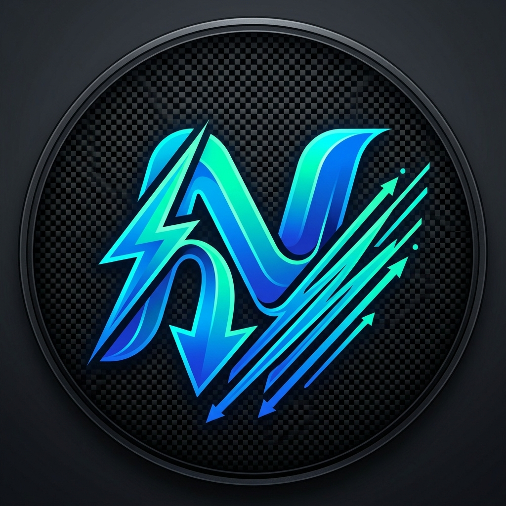
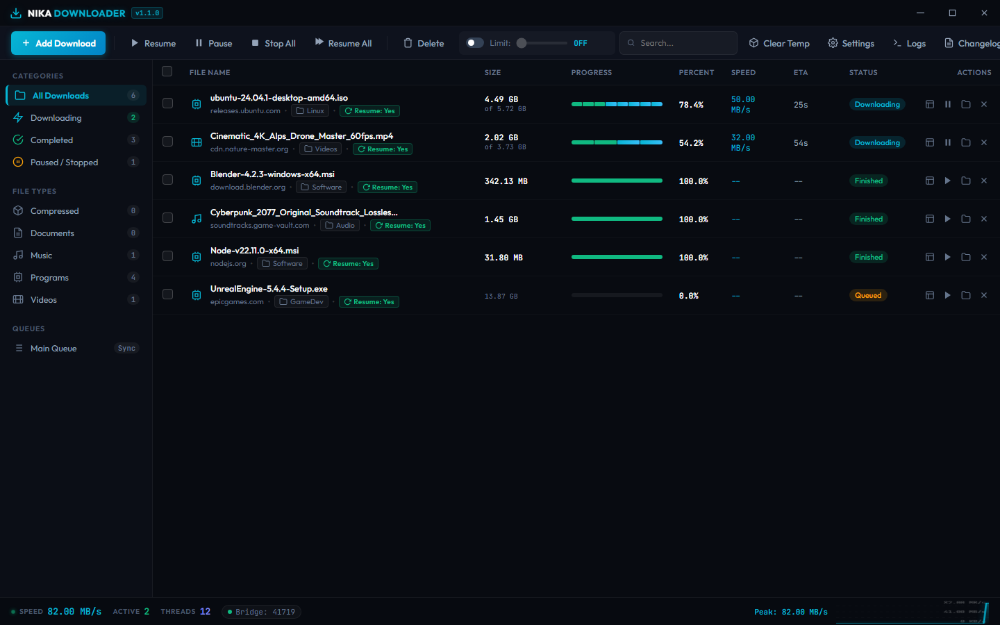
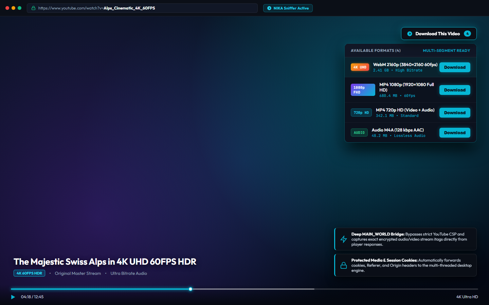
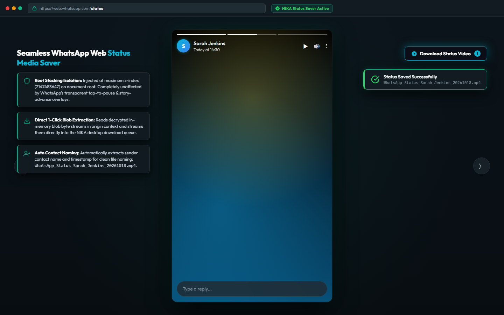

<p align="center">
  
</p>

<h1 align="center">NIKA DOWNLOADER</h1>

<p align="center">
  <strong>Next-Generation High-Performance Download Manager & Browser Stream Sniffer</strong>
</p>

<p align="center">
  <a href="https://github.com/jackingpanda/NIKA-DOWNLOADER/actions/workflows/ci.yml"></a>
  <a href="https://github.com/jackingpanda/NIKA-DOWNLOADER/releases"></a>
  <a href="LICENSE"></a>
  
  
  
</p>

---

## ⚡ Overview

**NIKA DOWNLOADER** is an open-source, high-throughput download manager built for speed, stability, and zero-loss recovery. Inspired by the battle-tested multi-connection chunking mechanisms of classic Internet Download Manager (IDM), NIKA is re-engineered from the ground up for modern operating systems using an asynchronous Node.js streaming core, sparse disk preallocation, an Electron desktop dashboard, and a Manifest V3 browser integration bridge.

Whether accelerating multi-gigabyte archives or sniffing 4K/1080p media streams directly from browser tabs, NIKA saturates your available bandwidth while maintaining strict data integrity.

---

## 📸 Visual Tour & Walkthrough

### 1. Modern Desktop Dashboard
> Clean frameless glassmorphism interface featuring 60 FPS real-time bandwidth telemetry (peaking at 82+ MB/s), multi-segment active thread progress monitors, categorized filters, speed limiting slider, and an authentic IDM-style right-click context menu.

<p align="center">
  
</p>

### 2. Floating Video Sniffer & Multi-Quality Stream Extractor
> Injects a floating capture badge onto embedded HTML5 and streaming players. Powered by an in-page `MAIN_WORLD` bridge that extracts adaptive video & audio formats across resolutions (4K UHD 60fps, 1080p FHD, 720p HD, and AAC/M4A audio) with automatic session cookie forwarding to bypass CDN restrictions.

<p align="center">
  
</p>

### 3. WhatsApp Web Status Media Saver
> Zero-layer obstruction architecture mounts the floating sniffer directly at the document root (`z-index: 2147483647`), completely bypassing WhatsApp Web's tap-to-pause and story-advance overlays. Extract in-memory decrypted blob media (videos and photos) in 1-click with automated contact-name file tagging.

<p align="center">
  
</p>


---

## 🚀 Key Features

### 🏎️ Multi-Segment Parallel Engine
- **Configurable HTTP Connections (1–32 Threads)**: Dynamically splits any byte-range capable remote file across worker sockets to bypass single-stream ISP or server throttling.
- **Dynamic Chunk Re-Splitting**: Slower segments are automatically bisected in real time by faster idle threads to prevent tail latency.
- **Sparse Disk Preallocation**: Zero-copy sparse file writes (`fs.promises.open`) eliminate file stitching overhead and disk fragmentation.

### 🌐 Manifest V3 Browser Integration
- **Universal Browser Support**: Compatible with Google Chrome, Microsoft Edge, Brave, and Opera.
- **Bi-Directional WebSocket Bridge (`127.0.0.1:41719`)**: Instantaneous IPC communication between browser service workers and the local download engine.
- **Full Header & Cookie Forwarding**: Automatically forwards active session cookies, Referer, and User-Agent headers to eliminate HTTP 403 Forbidden errors on protected CDNs.

### 🛡️ Crash Resilience & State Recovery
- **Atomic Progress Persistence (`.rea-meta`)**: Download offsets and segment maps are written atomically. If the system crashes, reboots, or is closed via the `[X]` button, downloads resume immediately without re-downloading finished bytes.
- **Temp Cache Manager**: In-app tool to calculate, inspect, and purge orphaned temp files and uncompleted chunk allocations.

### 📊 Real-Time Telemetry & Controls
- **Smooth Speed Limiter**: Token-bucket algorithm enables smooth bandwidth throttling from 100 KB/s up to unlimited.
- **Diagnostics & Log Viewer**: Live in-app log viewer with level filtering (`DEBUG`, `INFO`, `WARN`, `ERROR`), exportable to disk.
- **Window Layout Memory**: Preserves custom window dimensions, positions, and maximized states across sessions.

---

## 📈 Benchmark & Integrity Verification

A standardized benchmark was performed using an external OVH 10 MB test file:

```
Target File: https://proof.ovh.net/files/10Mb.dat (10,485,760 bytes)
Run 1: Standard Single-Stream Connection
Run 2: NIKA Multi-Segment Parallel Engine (8 Connections)
```

| Metric | Single Connection | NIKA Engine (8 Segments) | Performance Delta |
| :--- | :---: | :---: | :---: |
| **Duration** | `3.35s` | `2.29s` | **~1.46x Faster** |
| **Average Speed** | `2.98 MB/s` | `4.38 MB/s` | **+47% Throughput** |
| **SHA-256 Checksum** | `e5b844cc57f5...` | `e5b844cc57f5...` | **100% BIT-PERFECT MATCH** |

> *(Test environment: Windows 11 x64, Node.js v24.19.0, OVH Cloud Test Endpoint).*

---

## 🛠️ Quickstart Guide

### Prerequisites
- [Node.js](https://nodejs.org/) version **20.x** or higher.
- [Git](https://git-scm.com/).

### 1. Installation
Clone the repository and install project dependencies:

```bash
git clone https://github.com/jackingpanda/NIKA-DOWNLOADER.git
cd NIKA-DOWNLOADER
npm install
```

### 2. Launching Desktop Application
Start the Electron desktop interface with either of the following:

```cmd
# 1-Click Windows Batch Runner
start-desktop.bat

# Or via npm
npm run desktop
```

### 3. Launching Interactive CLI
NIKA also provides a standalone terminal interface:

```cmd
# 1-Click Windows Batch Runner
start-cli.bat

# Or direct CLI invocation
node src/cli.js https://example.com/file.zip -c 8 -o ./downloads
```

### 4. Installing the Browser Extension
1. Run the helper script:
   ```cmd
   install-browser-extension.bat
   ```
   *(Or run `npm run extension`)*
2. In Google Chrome, Brave, or Microsoft Edge, open the Extensions page (`chrome://extensions` or `edge://extensions`).
3. Toggle on **Developer mode** in the upper right corner.
4. Click **Load unpacked** and select the folder:
   ```
   <repo-root>/src/extension
   ```
5. The NIKA Downloader icon will now appear in your browser toolbar, automatically bridging to the desktop application.

---

## 🔄 Automated Version Checkpoint & Rollback System

NIKA includes a built-in rollback engine that safeguards production stability:

### 1-Click Interactive Menu (Windows)
Double-click `rollback.bat` or run:
```bash
npm run rollback
```

### Command-Line Usage
```bash
# List all available tagged checkpoints
node scripts/rollback.js list

# Mode 1: Safe Branch Isolation (Recommended)
# Creates and checks out branch "rollback/v1.0.0" leaving main untouched
node scripts/rollback.js to 1.0.0

# Mode 2: Linear Revert
# Reverts working directory files to target release and creates a clean revert commit
node scripts/rollback.js to 1.0.0 --restore

# Mode 3: Temporary Detached Inspection
node scripts/rollback.js to 1.0.0 --inspect
```

### GitHub Actions Workflow
You can also trigger an automated cloud rollback via the GitHub Actions tab (`.github/workflows/rollback.yml`) with on-demand branch or revert creation.

---

## 🗂️ Project Architecture

```
NIKA-DOWNLOADER/
├── .github/
│   ├── workflows/
│   │   ├── ci.yml                 # Automated unit & integration test pipeline
│   │   ├── release.yml            # Automated GitHub Releases on tag push
│   │   └── rollback.yml           # On-demand rollback workflow
│   ├── ISSUE_TEMPLATE/            # Bug report and feature request templates
│   └── pull_request_template.md   # Standardized PR review checklist
├── assets/                        # Project logos and UI showcase screenshots
│   ├── logo.png                   # Official NIKA DOWNLOADER brand emblem
│   ├── dashboard.png              # Main dashboard showcase mockup
│   ├── extension-sniffer.png      # Floating video sniffer & multi-quality preview
│   └── whatsapp-status-saver.png  # WhatsApp Web Status Downloader showcase
├── src/
│   ├── core/                      # High-throughput download engine
│   │   ├── probe.js               # HTTP Range & MIME prober
│   │   ├── chunk-calculator.js    # Dynamic byte partitioning & splitting
│   │   ├── storage.js             # Sparse disk preallocation & streaming writes
│   │   ├── segment-worker.js      # Native Node HTTP/HTTPS chunk worker
│   │   ├── downloader.js          # Multi-segment ReaDownloader orchestrator
│   │   ├── speed-limiter.js       # Token-bucket bandwidth limiter
│   │   ├── state-store.js         # Atomic JSON persistence & migration store
│   │   ├── logger.js              # Real-time diagnostic logging subsystem
│   │   └── queue-manager.js       # Priority task scheduler & category resolver
│   ├── desktop/                   # Electron desktop application
│   │   ├── main.js                # Main process, system tray, clipboard sniffer
│   │   ├── preload.js             # ContextBridge IPC secure sandbox
│   │   └── renderer/              # GUI Dashboard (HTML5 / Vanilla CSS / JS)
│   ├── bridge/                    # IPC WebSocket Daemon
│   │   └── server.js              # Port 41719 bridge for WebExtension clients
│   ├── extension/                 # Manifest V3 browser integration
│   │   ├── manifest.json          # Chrome / Edge / Brave extension manifest
│   │   ├── background.js          # Service worker & download interceptor
│   │   ├── content.js             # Floating sniffer UI injection
│   │   ├── yt-bridge.js           # In-page MAIN_WORLD YouTube extractor
│   │   └── popup.html / popup.js  # Toolbar quick-action controller
│   ├── cli.js                     # Standalone CLI entrypoint
│   └── index.js                   # Programmatic library exports
├── test/                          # Comprehensive automated test suite
│   ├── test-download.js           # Core segmentation & chunk integrity test
│   ├── test-queue.js              # Queue lifecycle & state persistence test
│   ├── test-bridge.js             # WebExtension WebSocket bridge test
│   ├── test-ui-functions.js       # UI action buttons & handlers test
│   └── test-benchmark.js          # OVH 10 MB end-to-end benchmark suite
├── scripts/
│   ├── changelog.js               # Semantic Version & Keep a Changelog manager
│   ├── rollback.js                # Checkpoint inspection & rollback tool
│   └── install-extension.js       # Unpacked browser extension setup guide
├── start-desktop.bat              # 1-Click Desktop GUI runner
├── start-cli.bat                  # 1-Click CLI runner
├── rollback.bat                   # 1-Click Rollback menu runner
├── install-browser-extension.bat  # 1-Click Extension setup guide
├── CHANGELOG.md                   # Chronological version release history
└── LICENSE                        # MIT Open Source License
```

---

## 🧪 Testing

Run the full end-to-end automated test suite:

```bash
# Run core download test
npm test

# Run all tests (Download, Queue, WebSocket Bridge, UI Handlers, and Benchmark)
npm run test:all
```

---

## 📜 Contributing & Guidelines

Contributions are welcome! Please ensure:
1. All changes adhere to the guidelines in [AGENTS.md](AGENTS.md).
2. Any new features or fixes are recorded into `CHANGELOG.md` via:
   ```bash
   node scripts/changelog.js add <added|fixed|changed> "Description of change"
   ```
3. All tests pass with `npm run test:all`.

---

## 📄 License

This project is licensed under the **MIT License** — see the [LICENSE](LICENSE) file for details.  
Copyright &copy; 2026 **NIKA Downloader Team** ([jackingpanda](https://github.com/jackingpanda)).
